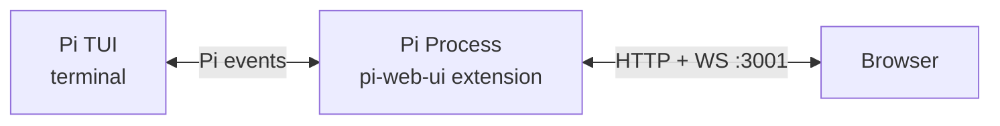

# Pi Web UI

A web UI for [Pi](https://github.com/badlogic/pi-mono) coding agent. Runs as a Pi extension inside your existing Pi process — no separate server needed.

> This fork is maintained at [swordfate3/pi-web-ui](https://github.com/swordfate3/pi-web-ui), based on [kkkiio/pi-web-ui](https://github.com/kkkiio/pi-web-ui), originally forked from [deflating/tau](https://github.com/deflating/tau). Thanks to both upstream projects.
> Includes protected session controls, complete long-session tree transport, Chinese/English UI, minimal responsive layout and interaction optimizations.

## What it does

Pi Web UI connects to your running Pi session and gives you a browser interface. Same session, same messages, same tools — just a different screen. Type in the terminal or the browser, both stay in sync.


- **Real-time streaming** — messages, tool calls, and thinking blocks
- **Conversation tree sidebar** — inspect the current session tree, select nodes without changing drafts, branch from user messages, and continue from branch ends
- **React UI** — Vite, Tailwind, shadcn/ui, AI Elements
- **Markdown rendering** — Streamdown for code blocks, math, Mermaid
- **No extra process for a single session** — the Pi extension *is* the server
- **Optional multi-session hub** — the same package supplies a separate portal/router; no WSL service required

## Install

Install from GitHub with Node.js 22.19+ (Node 24 recommended):

```bash
pi install git:github.com/swordfate3/pi-web-ui
```

The installation ref contains prebuilt frontend assets. Installation only needs the extension's production dependency (`ws`); no TypeScript/Vite build, development-dependency override or extra asset download is required. `prepare` verifies packaged files and fails if they are incomplete or stale. Pi supplies its own runtime APIs.

Update with:

```bash
pi update git:github.com/swordfate3/pi-web-ui
```

Then manually run `/reload`, `/webui` and refresh the browser. This update does not automatically reload an already-running Pi session. See [installation/release checks](docs/releasing.md) for the maintainer workflow.

The upstream version is also available from npm (it does not include this fork's unpublished changes):

```bash
pi install npm:@kkkiio/pi-web-ui
```

## Usage

1. Start Pi in your terminal
2. Type `/webui` — the extension uses the execution context to resolve the URL, enable advanced features, and open the browser

The server starts automatically when a Pi session begins and shuts down when the session ends.

For phone access, type `/webui-setup` locally or open **Settings → Remote access / Login management**.
The bilingual wizard generates reviewable connection and Caddy account-management materials;
it never accepts passwords or executes server administration in the browser. New remote
templates support Linux/OpenSSH/Caddy with one Pi session, not a multi-session router.
See [remote setup, password changes and recovery](docs/remote-access.md).

For several running Pi instances, the package also includes `pi-web-hub`:
one `/sessions/` page lists them and routes each independently. Start the hub
explicitly and give each Pi its own registration credential. It does not launch
agents or configure tunnels/authentication for you. See the
[multi-session operating guide](docs/hub.md) for local setup, Docker mount scopes,
persistence, restart behavior and the authenticated-gateway boundary.

## Features

### Chat
- Streaming text and thinking/reasoning blocks
- Tool call display with expand/collapse
- Workspace file attachments: use **Upload files** (paperclip), drop files or paste images; up to five files, **1 GiB each by default**. Files stream in **8 MiB chunks**, with integrity checks, progress, cancellation and retry from confirmed chunks. After a page refresh, reselect the original file to resume within the same running session. Saved files live under `.pi-uploads/<session>/<upload>/` before paths are sent to Pi, directly or through Hub. Images are file references for Pi to read on demand, not automatically inlined model images. See [upload behavior, configuration and limits](docs/prd/file-uploads.md).
- Click project-file paths in assistant replies to confirm a download, preserving the original filename (including Chinese); works directly or through Hub. See [download behavior and access limits](docs/prd/file-downloads.md).
- Branch from user messages and continue from branch ends via `navigate_tree` in the current session tree (requires `/webui` command context)
- Follow-up messages while the agent is streaming

### Model & Thinking
- Current model label and searchable model picker
- Thinking level cycle button
- Context-window visualization and compact suggestion

### Sessions
- Sidebar with the current conversation tree
- Bounded history: recent three calendar days by default; choose dates to read older messages without downloading the entire session
- Older pages replace the visible history window; oversized individual records show an explicit preview while original session files remain unchanged
- The `/resume` picker filters saved sessions by last activity in the chosen date range; the Hub portal still lists currently online Pi processes
- Search, expand/collapse, and select tree nodes without overwriting the input draft
- Branch from user messages when you want to edit an earlier prompt and continue in the same session
- Continue from non-user branch ends when you want to resume an existing branch without changing the draft

### Commands & Settings
- Command palette: compact, export HTML, session stats, tool toggle
- Light, dark, and system theme modes
- [Slash-command support matrix](docs/slash-command-support.md) compares Pi 1.1.0 commands with current Web UI behavior and limitations

## Configuration

Environment variables (set before starting Pi):

| Variable | Default | Description |
|----------|---------|-------------|
| `PI_WEB_UI_PORT` | `3001` | Server port |
| `PI_WEB_UI_HOST` | `127.0.0.1` | Bind address |
| `PI_WEB_UI_DISABLED` | `0` | Set to `1` to disable |
| `PI_WEB_UI_PUBLIC_URL` | *(none)* | Advertised HTTPS entry; does not create a tunnel |
| `PI_WEB_UI_REGISTRY_SOCKET` | *(none)* | Optional external registry IPC path |
| `PI_WEB_UI_REGISTRY_CREDENTIAL_FILE` | *(none)* | Capability file; required together with IPC path |
| `PI_WEB_UI_STATIC_DIR` | *(bundled)* | Override static files path |
| `PI_WEB_UPLOAD_MAX_BYTES` | `1073741824` | Version-2 per-file upload limit in bytes; hard ceiling 8 GiB |
| `PI_WEB_UPLOAD_MAX_PENDING_BYTES` | `2147483648` | Per-instance sum of incomplete uploads' declared sizes, not a quota on saved files |
| `PI_CODING_AGENT_DIR` | `~/.pi/agent` | Override Pi config directory |
| `PI_CODING_AGENT_SESSION_DIR` | *(derived)* | Override Pi session storage directory |

Or in `~/.pi/agent/settings.json`:

```json
{
  "pi-web-ui": {
    "port": 3001,
    "host": "127.0.0.1"
  }
}
```

Pi Web UI follows Pi's `PI_CODING_AGENT_DIR` and `PI_CODING_AGENT_SESSION_DIR`
overrides when reading settings and current session state.

Local use does not require WSL or Docker. Explicit environment values override
settings. Occupied ports advance within a time/range bound, not a fixed instance
count. Reverse-proxy subpaths are supported natively. See the
[connection guide](docs/connection.md) for LAN/mobile access, public URLs, optional
registration, Docker mount requirements and authentication boundaries.

### Start / Stop

```
/webui-stop     Stop the server
/webui-start    Start it again
```

To prevent auto-start:

```bash
PI_WEB_UI_DISABLED=1 pi
```

## Security

Pi Web UI binds to `127.0.0.1` by default — accessible only from your local machine. For remote access, use `tailscale serve` or a reverse proxy with TLS. There is no built-in authentication; it's unnecessary for local-only access and insecure over cleartext.

## How it works

Pi Web UI is a [Pi extension](https://github.com/badlogic/pi-mono#extensions). When Pi starts a session, the extension starts an HTTP + WebSocket server inside the Pi process. The extension subscribes to Pi events and forwards them to the browser. Commands from the browser execute via the extension API using the `ExtensionContext` that Pi provides.



## Documentation

Project documentation lives under [`docs/`](docs/README.md), including the [development log](docs/development-log.md), [validation reports](docs/validation/README.md), and [release guide](docs/releasing.md).

## Development

```bash
git clone https://github.com/swordfate3/pi-web-ui.git
cd pi-web-ui
npm ci --legacy-peer-deps
npm run build:web
npm run verify:dist
PI_WEB_UI_STATIC_DIR=$(pwd)/dist pi
```

For frontend development, run Pi in one terminal, then:

```bash
npm run dev:web
```

After source changes, run `npm run build:web` and commit the corresponding `dist/` and manifest. Development dependencies are needed for maintainer builds/tests, not for Git package consumers.

Open `http://localhost:4444`; Vite serves the React UI and proxies `/api` and `/ws` to the extension on `localhost:3001`.

## License

[MIT](LICENSE). Upstream attribution is preserved; see [license provenance](docs/license-provenance.md).

### 网页鲸鱼娘

页面内可选悬浮鲸鱼娘支持拖动、点击反馈、收起、关闭，以及当前会话全部分支的 Token / 按实际响应模型划分的 USD 估算费用。互动不调用模型。缺少价格时显示未知；估算不等于实际账单。

在 **设置 → 鲸鱼娘** 导入本地 PNG/WebP/GIF（最少一张待机图，最多五个状态，每张 ≤2 MiB、每边 ≤2048 像素）。GIF 原动画可直接播放，启用网页或系统「减少动画」时显示静态首帧；图片仅保存在本浏览器当前站点，不上传给 Pi，不随软件包分发。未导入时使用小鲸鱼表情。关闭后也可从设置重新开启。详见 [产品说明](docs/prd/whale-companion.md)。
