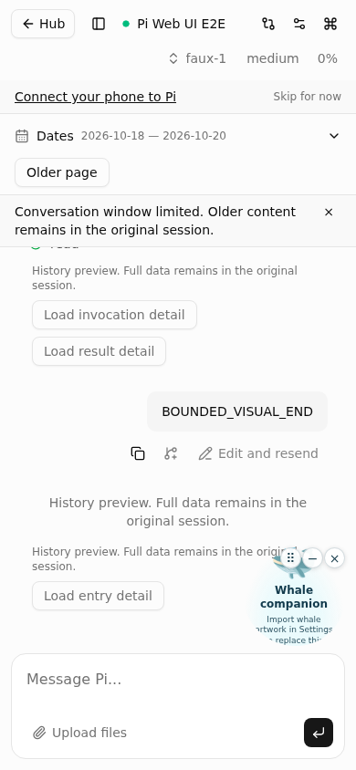
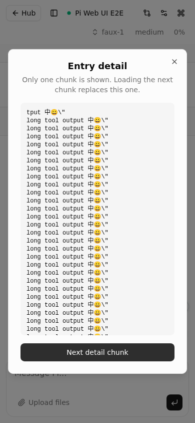

# Bounded Hub state: integration and visual evidence

Date: 2026-10-20. Source-only validation on `codex/bounded-hub-state`, based on
reviewed Tasks 1–2 (`7471c87`). No production rollout, host Compose edits, real
credentials/models, Pi source-history cleanup or Gate-record changes.

## Guarantees and exclusions

| Boundary | Enforced budget |
| --- | --- |
| Complete state_sync / get_history / sync_request UTF-8 JSON before compression | 256 KiB / 262,144 bytes |
| History page | 40 entries, 192 KiB array, 16 KiB each |
| Tree preview | 200 nodes, 32 KiB |
| Complete entry-detail response | 64 KiB, fenced to session/runtime/branch/revision |
| Browser retained source-like content | 200 items, 512 KiB total, 64 KiB each, plus one detail chunk |
| Hub logical persistent state | 8 MiB; ordinary writes preserve 64 KiB security headroom |
| Active grants | 512, including deliberately offline grants |
| Forwarding in each direction | 512 KiB waiting / 512 messages, PLUS one ≤16 MiB in-flight message |
| Browser WebSocket pairs | 8 concurrent, including pending proofs/handshakes; not an eight-Pi-run cap |

Queues retain credit until send completion and buffer drain. An oversized second
message cannot wait; slow consumers close with 1013. Eight full pairs admit up to
264 MiB forwarding payload, **not** total RSS. Other runtime limits: 128 raw HTTP
connections across listeners; 64 IPC peers / 32 admitted IPC operations; four
backend probes; two WS and two static compression operations. Five independent Pi
runs are separately covered by the Task 2 unit suite. No 512 MiB cgroup stress or
constant CPU/RSS claim is made. Pi core getBranch/getTree and session memory may
scale with original history; browser React/JS overhead is outside serialized
retention. Initial JS/CSS, explicit upload/download and lifetime traffic are outside
the history-frame budget. No fixed phone latency or Docker named-volume quota.

Original Pi JSONL/model context, project files and Gate deployment records are never
modified/deleted by these bounds. Preview text is deterministic omission, not an LLM
summary. Detail retrieval is explicit, current-branch only, no arbitrary paths or
base64 binary bodies, and never automatically prefetches/concatenates the original.

## Measured real-Pi and packaged-Hub results

`e2e/date-history.integration.ts` measures raw WebSocket UTF-8 envelopes, not payload
arrays or compressed sizes. It checks all received history/sync/detail envelopes,
all older pages, date replacement, invalid offsets/signatures, cross-session/runtime
and entry identity, actual branch navigation invalidating cursors, off-branch denial,
and unchanged temporary 20 MiB JSONL. Registration must be bounded-v2 through the
rebuilt packaged Hub, not legacy fallback. A first representative passing run:

| Measurement | Bytes/count |
| --- | ---: |
| Largest full history envelope | 41,093 |
| Largest full detail envelope | 65,523 |
| Largest entries array / individual entry | 7,410 / 449 |
| Largest tree preview | 32,675 |
| Initial page entries / tree nodes | 40 / 104 |
| Non-overlapping recent pages / unique entries | 4 / 154 |
| Temporary JSONL file | 20,999,720 bytes |

The 154 includes 152 fixture messages and two real Pi startup metadata entries.
Before and after SHA-256:
`a1af24495580855fba57f58597e868b9520fe4ef48aa32f7a4a48ec597a845b1`.
Fixture timestamps/temp workspace paths make hashes differ across runs; equality
within each run is asserted. Unicode/escape-heavy detail is also exercised by the
real persisted tool fixture; adversarial metadata and revision-content mutation
fences remain covered by the unit tests, without rewriting a real session for testing.

## Screenshot evidence (honest fallback)

No callable in-app Browser automation was available. Used local Playwright Chromium
selected by `PI_E2E_BROWSER_EXECUTABLE`, real Pi RPC/WS, packaged Hub and temporary
synthetic sessions. No mocked WS/routes, DOM/store injection or production URL.
Finite screenshot animations are completed so dialogs are captured at rest.
Exact ephemeral localhost URLs, viewports and per-run JSONL hashes are in
[evidence.json](artifacts/bounded-hub-state/evidence.json); servers are stopped after
each run, so those URLs are evidence identifiers, not live services.

Artifacts use `{history|tools}-{1440|390}-{preview|detail-first|detail-next|scope-reset|old-date}.png`
under `docs/validation/artifacts/bounded-hub-state/`. Desktop is 1440×1000; mobile is
390×844. The implementer inspected the actual images; controller independently
inspected 12 representative images and confirmed the changed controls/dialog text,
close/next buttons fit, chunks visibly replace, and branch/date changes clear detail.

- Preview notice and **Load entry detail** are visibly available, including a
  synthetic system row for a tool result whose merged invocation row was evicted
  by the 200-item browser limit. Fixture has 205 persisted tool calls, not injected UI.
- Long Unicode/escaped tool output is readable in the scrollable chunk area.
  First/next history texts are 65,145 bytes each; tool texts 58,621 / 58,619 bytes.
  These text sizes are not substitutes for the full-envelope checks above.
- Exactly two user-requested detail reads per case; next chunk no longer has the
  first-chunk marker. Actual Pi branch navigation while detail is open closes it;
  subsequent date selection displays only the old marker, with no stale dialog.
- All four cases: zero page errors and no page horizontal overflow. No assertion
  of global zero overlap: existing Whale companion overlaps some bottom-right
  ordinary chat/notice text, especially on mobile, but not detail buttons/modal
  controls. Synthetic system previews repeat the notice in the text row and control
  span. Both observations remain for final review. Neither issue was hidden by
  removing the widget.




## Storage safety, migration and operator boundary

All writers (CLI issue/revoke, serve registration, authentication and receipts/clocks)
must use the same cross-process lock/quota implementation. Stop/upgrade old writers,
then Hub, then Pi extensions and browser assets. Build tracked dist **before**
packaged integration: an old unmodified Hub fails closed with new clients; only a
signed, explicit unsupported-protocol response permits legacy negotiation fallback.

New generations are `b2-<boot32hex>-<slot16hex>-<nonce32hex>`; old 32hex generations
remain supported. Run/operation IDs remain 32hex. All legacy tombstones are retained,
including revoked-run tombstones; deleting them could allow old URLs to be reused.
No automatic downgrade/legacy compaction is supported. Bounded tuples replace per-run
records and reject replay after supersession/unregister/boot change.

Offline grants are not expired. Revoked grant/receipt GC is **not enabled** without
proof that every dependency / Gate terminal state / idempotency retention obligation
has ended. Seven-day receipt TTL is conditional design, not active cleanup. Receipts
also have the existing 1,000-count ceiling. Quota refusal preserves existing data,
does not trigger broad deletion, and does not promise unlimited run churn. Ordinary
writes stop at quota; existing active grants can be revoked subject to remaining
byte/staging capacity. Already unsafe/oversized state can refuse startup too.

Credential issue first commits the grant and conservative export reservation, then
publishes the external export. Failed/uncertain export leaves that authoritative
reservation intact; removing an export later does not free accounting. Legacy exports
without accounting are not discovered by scanning unrelated directories.

`GET /api/management/storage` is available only on the authenticated management
origin, reporting aggregate bytes/counts/budgets/export reservations/overBudget,
never tokens, paths, prompts or run identities. No new public/CLI diagnostic.
Locks are not automatically stolen by PID or age. Trusted recovery must establish
all relevant services/writers are stopped and handle only the verified specific lock;
never recursively remove state, legacy proofs, unknown files or symlinks. See
[Hub operations](../hub.md) for the full boundary.

Recommend Docker log rotation **2 MiB × 3**, retaining container memory/tmpfs limits.
This is a documentation recommendation only; no host Compose/log settings changed.

## Reproduction

```sh
npm run build:web
npm run verify:dist
npm run test:unit
npx tsc --noEmit
npx tsc -p tsconfig.connection.json --noEmit
npm run check
node --import ./tests/register-ts.mjs --test --test-concurrency=1 --test-reporter=spec e2e/date-history.integration.ts e2e/session-hub.integration.ts e2e/message-revision.integration.ts e2e/file-download.integration.ts e2e/file-upload.integration.ts
npm run e2e:gen
# Set PI_E2E_BROWSER_EXECUTABLE to an approved local Chromium executable.
./node_modules/.bin/playwright test -c e2e/playwright.config.ts --grep '恢复、统计|总管连接|恢复会话自动|@date-history'
node --import ./tests/register-ts.mjs e2e/harness/visual-bounded-hub-state.ts
```

## Verification results and diagnostic history

| Verification | Result |
| --- | --- |
| Manifest regression (`node --test --test-reporter=spec tests/web-dist.test.mjs`) | 44 pass, 0 fail; missing four-module inventory first reproduced RED |
| `npm run build:web` | Exit 0; browser 5,693 modules, packaged Hub 21 modules / 168.47 kB; manifest written |
| `npm run verify:dist` | Exit 0; source and output hash consistency verified |
| Complete `npm run test:unit`, including packaged hub-cli | 584 total: **583 pass, 0 fail, 1 pre-existing skip**; 43,523 ms |
| `npx tsc --noEmit` | Exit 0, no diagnostics |
| `npx tsc -p tsconfig.connection.json --noEmit` | Exit 0, no diagnostics |
| `npm run check` | Exit 0; 261 files, **0 errors, 33 warnings, 7 infos** |
| Serial backend integrations (five files listed above) | **9 pass, 0 fail**, final rebuilt-artifact run 82,773 ms |
| Serial Playwright date/resume/Hub scenarios | **7 pass, 0 fail**, 55.8 s; run after backend integrations, one worker |
| Real-flow visual runner | Four cases, 20 PNGs; zero page errors / page horizontal overflow; all four JSONL hashes unchanged |
| `git diff --cached --check -- ':!dist'` | Exit 0 for source/docs; full staged check reports four generated-bundle trailing-whitespace lines |

The skipped unit case is the pre-existing opt-in 1 GiB upload stress test, not a
skipped file or disabled packaged Hub suite. Existing Node module-type, Vite large
chunk and Playwright color-environment warnings remain; the result is not warning-free.
No optional Docker-managed-runtime harness, production deployment or cgroup stress
run is claimed.

Final rebuilt-artifact history run reproduced all byte/count maxima in the table
above. Its temporary JSONL before/after SHA-256 was
`be8e9db9446774520ec1bd91f8e2d5f6906d48824c6dd467c86cabf75d9eb77a`.
The generated main bundle `dist/assets/index-DTKR0QRq.js` has trailing whitespace
at lines 59, 703, 721 and 910 (full staged whitespace check exits 2). It is retained
exactly as generated, not hand-edited; build/manifest verification passes. Source
and documentation whitespace checks pass. All temporary Pi/Hub/browser processes
are stopped by the test harnesses.

The upload integration uses the installed Pi SDK's own Undici fetch, matching its
global dispatcher; Node 22's bundled fetch otherwise rejects zero-length PUT before
the HTTP request reaches the product. No dependency or production upload change.
The initial upload run had three failures; a localhost-only reproduction returned
`UND_ERR_INVALID_ARG` with Node fetch versus HTTP 200 with SDK fetch. All original
HTTP assertions remain. Two initial browser card/focus failures were traced to
version metadata changing from `checking` to `unavailable`, despite unchanged
session data. Tests now wait for initial version lookup completion, refresh, and
assert both response equality and the original DOM identity/focus across a poll.

One initial backend run reported `Hub CLI issue failed`; two independent reruns
and a subsequent complete run passed. The initial safe harness intentionally did
not expose child stderr, so its cause is unproven. A fixed, whitelisted lock-busy
diagnostic was added; no blind retries or lock-policy weakening. This remains a
recorded intermittent setup observation, not a claimed production defect/fix.
